  <h1>Hi there 👋, I'm Tung Nguyen</h1>
  <h3>Business Intelligence Engineer · Analytics Engineer · Data Engineer</h3>
  

    <i>"Building the data layer between source systems and business decisions — from data pipelines and analytics models to BI."</i>
  

  

    
    &nbsp;
    
    &nbsp;
    
    &nbsp;
    
  

## 💼 Experience

<table>
  <tr>
    <th align="left">Company</th>
    <th align="left">Role</th>
    <th align="left">Period</th>
  </tr>
  <tr>
    <td><a href="https://www.vpbank.com.vn"><b>VPBank</b></a></td>
    <td><b>Business&nbsp;Intelligence&nbsp;Engineer</b></td>
    <td><b>Dec&nbsp;2025&nbsp;–&nbsp;Present</b></td>
  </tr>
  <tr>
    <td><a href="https://cmcglobal.com.vn"><b>CMC&nbsp;Global</b></a></td>
    <td>Data&nbsp;Engineer</td>
    <td>Jul&nbsp;2025&nbsp;–&nbsp;Dec&nbsp;2025</td>
  </tr>
  <tr>
    <td><a href="https://www.prompcorp.com.au"><b>PrompCorp</b></a></td>
    <td>Data&nbsp;Engineer&nbsp;Intern</td>
    <td>Mar&nbsp;2024&nbsp;–&nbsp;May&nbsp;2024</td>
  </tr>
  <tr>
    <td><a href="https://naviworld.com.au"><b>NaviWorld&nbsp;Australia</b></a></td>
    <td>Data&nbsp;Engineer&nbsp;Intern</td>
    <td>Jan&nbsp;2024&nbsp;–&nbsp;Mar&nbsp;2024</td>
  </tr>
</table>

## 🛠️ Skills

<table>
  <tr>
    <td><b>💻&nbsp;Languages</b></td>
    <td>
      
      
      
      
    </td>
  </tr>
  <tr>
    <td><b>🏢&nbsp;Warehouse&nbsp;&amp;&nbsp;Lakehouse</b></td>
    <td>
      
      
      
      
      
      
    </td>
  </tr>
  <tr>
    <td><b>🔄&nbsp;Data&nbsp;Engineering&nbsp;&amp;&nbsp;Orchestration</b></td>
    <td>
      
      
      
      
      
      
    </td>
  </tr>
  <tr>
    <td><b>📊&nbsp;BI&nbsp;&amp;&nbsp;Analytics</b></td>
    <td>
      
      
      
      
      
      
    </td>
  </tr>
  <tr>
    <td><b>🗄️&nbsp;Databases</b></td>
    <td>
      
      
      
      
    </td>
  </tr>
  <tr>
    <td><b>☁️&nbsp;Cloud&nbsp;&amp;&nbsp;DevOps</b></td>
    <td>
      
      
      
      
      
    </td>
  </tr>
  <tr>
    <td><b>🧰&nbsp;Tools&nbsp;&amp;&nbsp;Collaboration</b></td>
    <td>
      
      
      
      
      
      
    </td>
  </tr>
</table>

## 📊 GitHub Stats

  <table>
    <tr>
      <td width="52%" align="center" valign="middle">
        
      </td>
      <td width="48%" align="center" valign="middle">
        
          
        
      </td>
    </tr>
  </table>

